# CEEMDAN-CNN-GRU-GlobalAttention + XGBoost Combination Prediction

1. The dataset for power transformers, wind speed data, and datasets preprocessed by CEEMDAN with generated models, labels, and corresponding code can all be run. Additionally, there are examples of CEEMDAN decomposition.
2. The CNN-Transformer + XGBoost model has smaller MSE and MAE, showing significant performance improvements.
3. Code for preprocessing the data using CEEMDAN, complete CNN-Transformer prediction code, XGBoost prediction model code, and visualization code.
4. Environment: Python 3.9 PyTorch 1.8 or above.
5. Combination prediction model idea: Use complex models to predict the component features of the data, as complex models have a large parameter set and are suitable for predicting high-frequency complex feature components. However, low-frequency feature components are simpler. If complex models are used again, it may lead to overfitting and poorer results. Therefore, for low-frequency feature components, simple models (or machine learning models) are used for prediction, followed by prediction component reconstruction to achieve high-precision prediction.
6. Innovation 1: By using CNN convolutional pooling layers to reduce sequence length and increase data dimensionality, then feeding into GRU-GlobalAttention for global temporal feature learning, the model's ability to capture global context information in sequences is improved;
7. Innovation 2: Based on GlobalAttention optimized GRU network, GlobalAttention is a mechanism used to enhance the model's focus on different parts of the input sequence. In the GRU model, the global attention mechanism helps the model better focus on the most relevant parts of the input sequence, thereby improving the model's performance and generalization capabilities. At each time step, the global attention mechanism calculates a weight vector indicating the model's focus on different parts of the input sequence. Then these weights are applied to the feature representation of the GRU output, allowing the model to more specifically focus on important temporal features by weighting all positions of the features;
Innovation 3: Classify the components of the time series decomposed by CEEMDAN algorithm through sample entropy calculation, and then use the CNN-GRU-GlobalAttention model and XGBoost model for combined prediction to achieve precise predictions.
Note: This product also includes accompanying model explanations and parameter tuning guidance!
Preface
This article introduces a comprehensive application method that integrates the complete set empirical mode decomposition (CEEMDAN) with a combination prediction model (CNN-GRU-GlobalAttention + XGBoost), aiming to improve the predictive performance of time series data. The core of this method is to use the CEEMDAN algorithm to decompose the time series, followed by modeling the decomposed data using the CNN-GRU-GlobalAttention model and XGBoost model, and finally integrating the results of both models.
Detailed introduction to the power transformer dataset can be found in the following text:
Introduction to Power Transformer Dataset
1. Power Transformer Data Decomposition and Visualization with CEEMDAN
1.1 Importing Data
1.2 Decomposition of Power Transformer Data with CEEMDAN
Based on the decomposition results, CEEMDAN has decomposed into 11 components, and then calculate the sample entropy value of each component for analysis. Sample entropy is a method used to measure the complexity of a sequence, which can evaluate its complexity by calculating uncertainty within the sequence. The higher the sample entropy, the greater the complexity of the sequence.
We roughly classify the first 6 high sample entropy complex components as input for the CNN-GRU-GlobalAttention model for prediction, and the last 5 low sample entropy simple components as input for the XGBoost model for prediction.
2. Data Preparation and Preprocessing
2.1 Division of Dataset
Training set and test set are divided into 9:1 ratio, then further divided into 6:5 components.
When dealing with LSTF issues, selecting the appropriate window size is crucial. The right choice of window size can help the model better capture patterns and features within time series. To extract longer dependencies for modeling in sequence, this paper increases the window size to 24. It employs the CCEMDAN-CNN-GRU-GlobalAttention model to fully extract feature information from the first six components sequences.
Save data in batches for predictions by different models.
\t  
3. Combination Prediction Model Based on CEEMDAN
\t3.1 Define the CNN-GRU-GlobalAttention network model
\t  
3.2 Set parameters and train the model
50 epochs, MSE is 0.001372. The prediction effect of CNN-GRU-GlobalAttention is significant. The model can fully extract the temporal and spatial features of time series, has a fast convergence speed, superior performance, high prediction accuracy. If appropriately adjusted, the model parameters can further improve the model's predictive performance.
\tNote: Adjust parameters.
\tIt is appropriate to increase the number of CNN layers and the dimensionality per layer, and fine-tune the learning rate.
Adjust the number of GRU layers, the number of neurons per layer, and the attention dimensionality to increase more epochs (note to prevent overfitting).
\tThe sliding window length can be changed (set an appropriate window length).
Save the training results and prediction data to be combined with the results of the subsequent XGBoost model.
4 Model Prediction Based on XGBoost
\tThe tutorial for the traditional machine learning model XGBoost is as follows:
Super Predictive Algorithm: XGBoost Predictive Model
Data loading, training data and test data grouping, 5 components, divided into 5 datasets.
\t  
Save the predicted data, and other components' predictions are consistent with the above process, retaining the final model results.
5 Results Visualization and Model Evaluation
5.1 Visualization of component prediction results
5.2 Visualization of combined prediction results
5.3 Model evaluation
From the component prediction results, it is evident that the first six complex components fit well under the CNN-GRU-GlobalAttention prediction model, while the last five simple components fit exceptionally well under the XGBoost model's prediction, showing significant combined prediction effects!
Previously outstanding content:
Time series forecasting: Analysis and comparison of LSTM, ARIMA, Holt-Winters, SARIMA models
Wind speed prediction (I) Data introduction and preprocessing
Wind speed prediction (II) EMD-LSTM model based on Pytorch
Wind speed prediction (III) EMD-LSTM-Attention model
Wind speed prediction (IV) EMD-Transformer model based on Pytorch
Wind speed prediction (V) EMD-CNN-LSTM model based on Pytorch
Wind speed prediction (VI) EMD-CNN-GRU parallel model based on Pytorch
CEEMDAN + combined prediction model (BiLSTM-Attention + ARIMA)
CEEMDAN + combined prediction model (CNN-LSTM + ARIMA)
CEEMDAN + combined prediction model (Transformer - BiLSTM + ARIMA)
CEEMDAN + combined prediction model (CNN-Transformer + ARIMA)
Multi-feature variable sequence prediction (I) — CNN-LSTM wind speed prediction model
Multi-feature variable sequence prediction (II) — CNN-LSTM-Attention wind speed prediction model
Multi-feature Variable Sequence Prediction (III) - CNN-Transformer Wind Speed Prediction Model
Multi-feature Variable Sequence Prediction (IV) Transformer-BiLSTM Wind Speed Prediction Model
Multi-feature Variable Sequence Prediction (V) CEEMDAN+CNN-LSTM Wind Speed Prediction Model
Multi-feature Variable Sequence Prediction (VI) CEEMDAN+CNN-Transformer Wind Speed Prediction Model
Prediction Model Based on the SSA of Sparrow Optimization - CEEMDAN-BiLSTM-Attention
Prediction Model Based on the SSA of Sparrow Optimization - CEEMDAN-Transformer-BiGRU
Superior Prediction Model: Secondary Decomposition-Combination Prediction
Multi-feature Variable Sequence Prediction (VII) CEEMDAN+Transformer-BiLSTM Prediction Model
Multi-feature Variable Sequence Prediction (VIII) Prediction Model Based on the SSA of Sparrow Optimization for CEEMDAN-SSA-BiLSTM
Multi-feature Variable Sequence Prediction (11) Prediction Model Based on Pytorch's TCN-GRU
VMD + CEEMDAN Secondary Decomposition, CNN-LSTM Prediction Model
VMD + CEEMDAN Secondary Decomposition, CNN-Transformer Prediction Model
VMD + CEEMDAN Secondary Decomposition, Transformer-BiGRU Prediction Model
Prediction Model Based on the SSA of Sparrow Optimization - Code All-in-One Kit
Introduction to Electric Power Transformer Data Set and Preprocessing
SCI 1 Region High Innovative Prediction Model!
END

## Images

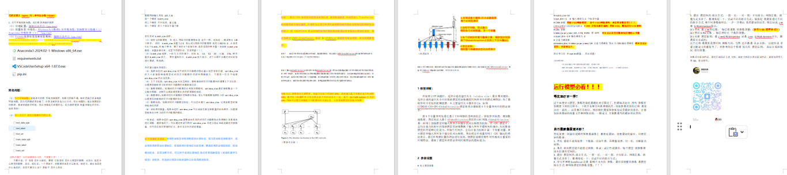
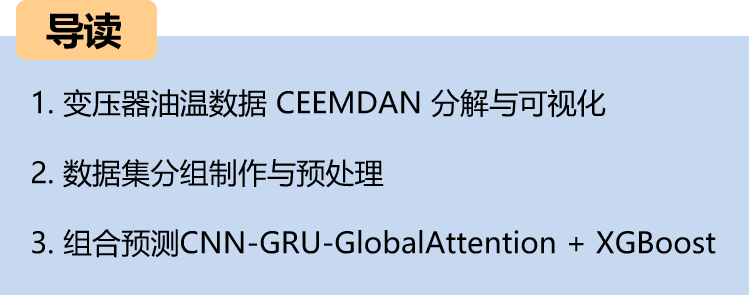

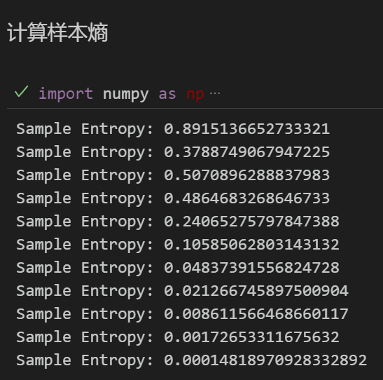
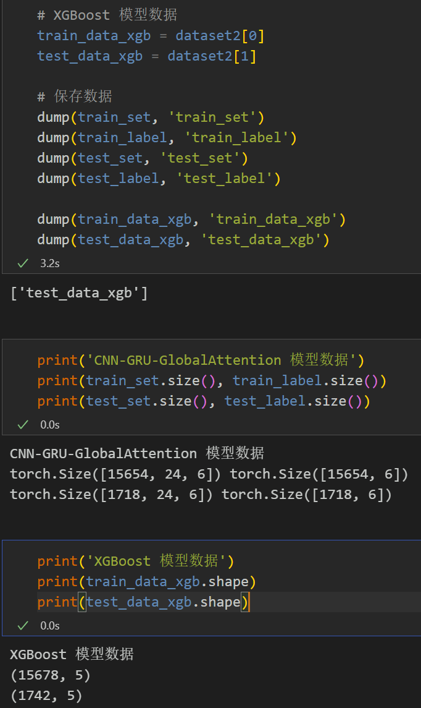
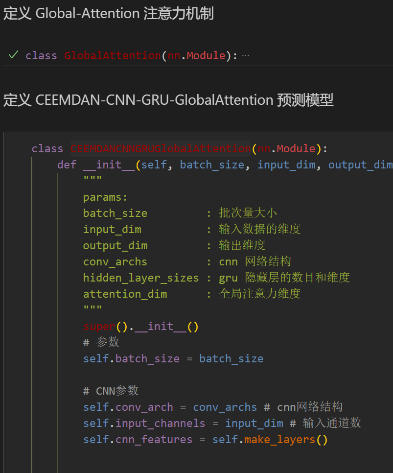
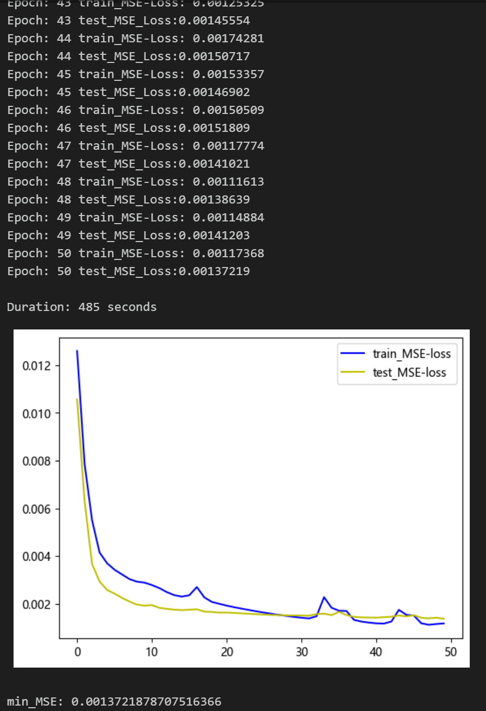
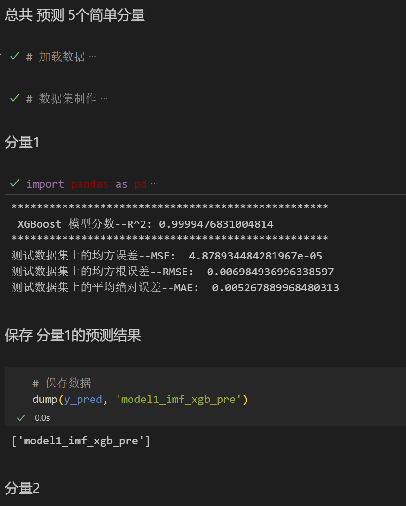
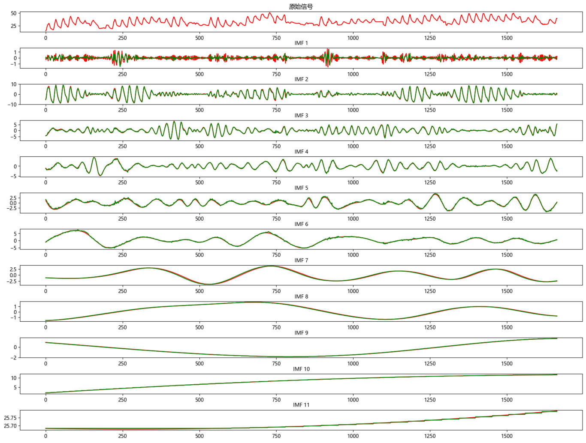
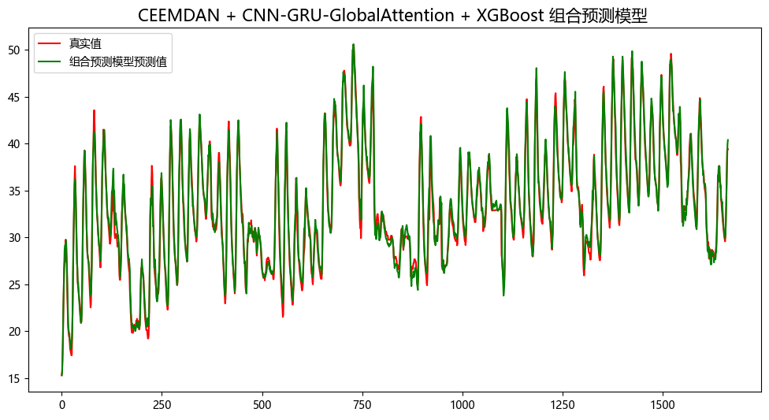
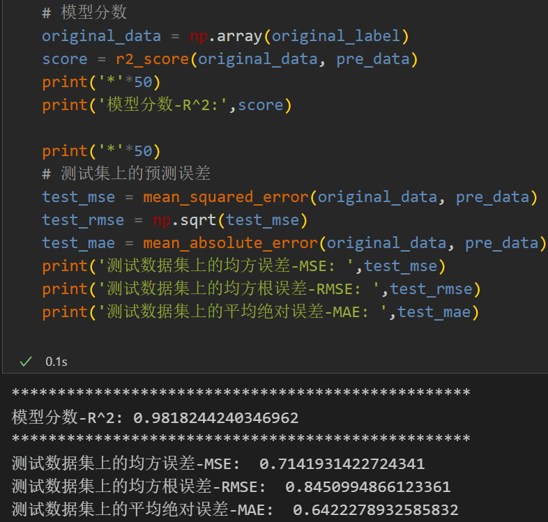
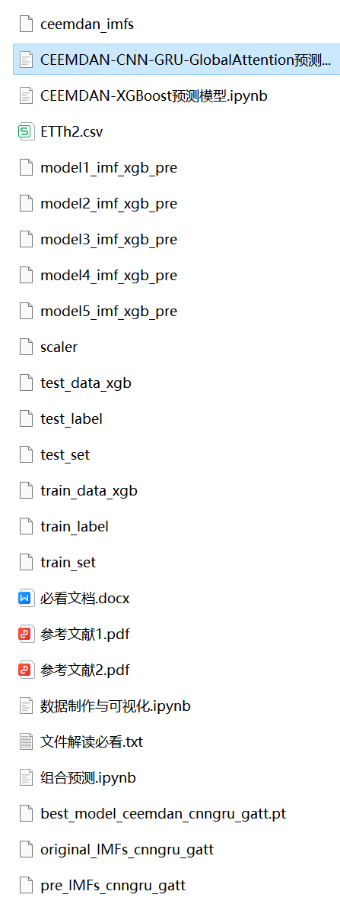

<!-- PAYMENT_BLOCK -->

## Get this dataset

- Payment link (Stripe): [Buy now](https://buy.stripe.com/3cs8yP7sY87d0vu9AB)
- Payment QR code: 

<!-- /PAYMENT_BLOCK -->
